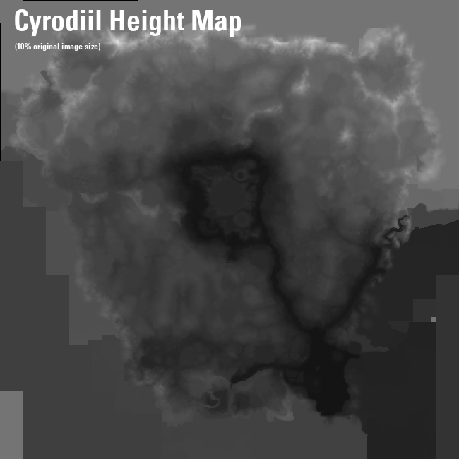

### References

https://en.uesp.net/wiki/ESO_Mod:Land_Data_Format

https://en.uesp.net/wiki/ESO_Mod_talk:Land_Data_Format

Discord messages from `@thefalcon19` in the ESO Model Viewer [discord](https://discord.gg/ZaPwNHKQBg)



### Stuff from above re-hashed

ESO terrain is made up of 65x65 data cell, that are grouped together in 5 chunks, and ultimately combined together to create the terrain

Each 65x65 cell is equivalent to a 100x100m world space area.

The height data is stored as a u16 float, but maps from 0-1000m (black to white)

Each worldid has related Terrain file summarized by a table of contents. To get this table of contents, use esoextractdata with the folloing command:
```shell
esoextractdata eso.mnf .\export\ -m mnf_file_table.txt
```

Then use those indexes to derive position in the world:
```c++
   uint64_t GetFileId(uint world, uint x, uint z, uint type, uint zero)
   {
       return ((ulong)(world & 0x7ff) << 0x25) + (ulong)(x << 0x10) | (ulong)(ushort)z | (ulong)(type & 0x1f) << 0x20 |
           (ulong)(zero | 0x40000000) << 0x20;
   }
```
