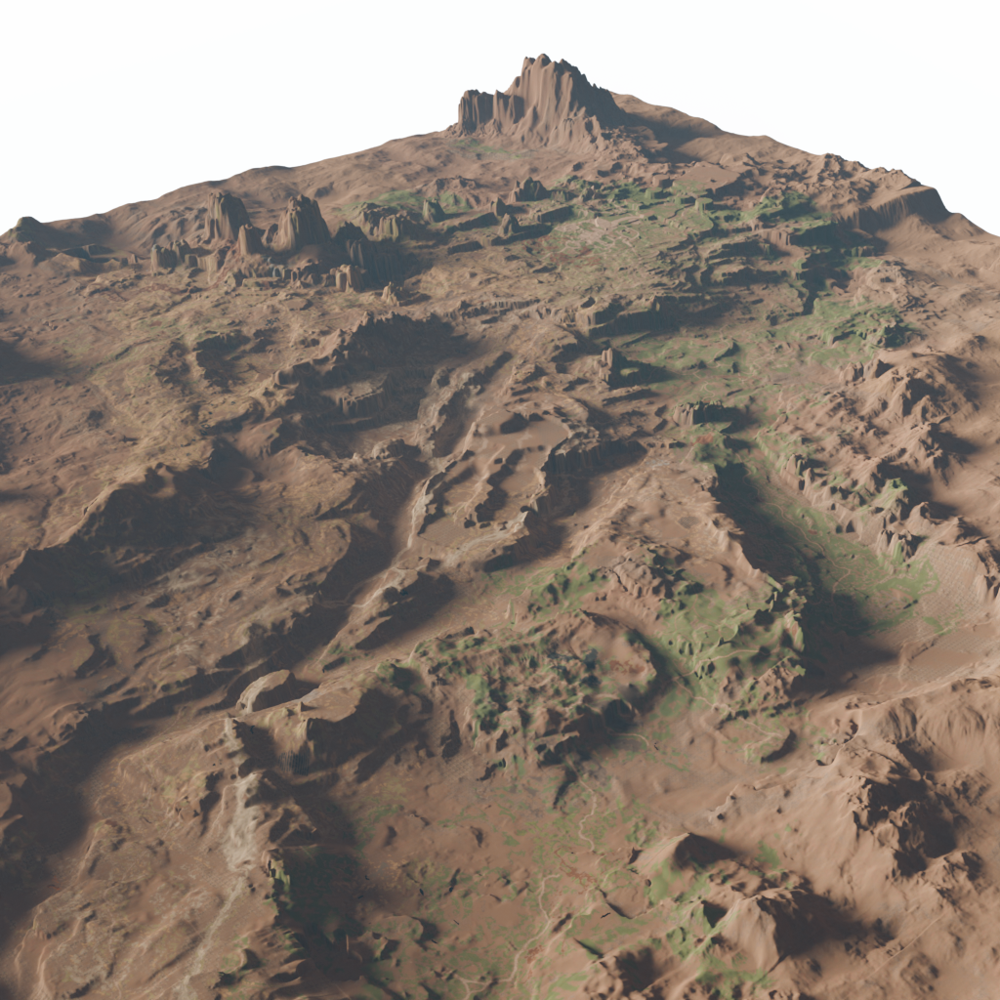

### References

https://en.uesp.net/wiki/ESO_Mod:Land_Data_Format

https://en.uesp.net/wiki/ESO_Mod_talk:Land_Data_Format

Discord messages from `@thefalcon19` in the ESO Model Viewer [discord](https://discord.gg/ZaPwNHKQBg)

https://github.com/uesp/uesp-esoapps/blob/master/EsoLand/EsoLand/EsoLand.cpp




Exports the heightmap data, colourmap, model fixture locations, dev overlay and some other data that idk what it is yet

Also has functionality for exporting some file tables, like every furniture model and every non-human creature model.

generate mnf with (as documented in esoextractdata readme)
```shell
EsoExtractData.exe "C:\Program Files (x86)\Steam\steamapps\common\Zenimax Online\The Elder Scrolls Online\depot\eso.mnf" .\export\ -m eso_mnf.csv
```